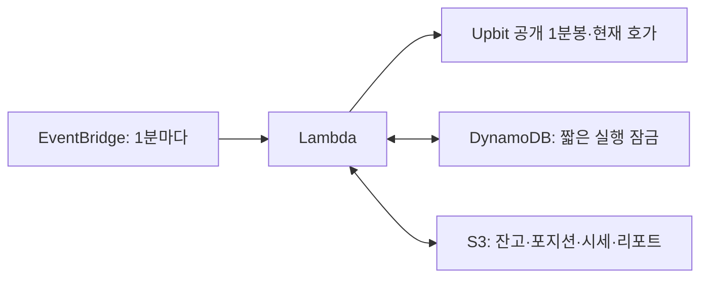

# AWS 1분 간격 Lambda 시뮬레이션

서울 리전(`ap-northeast-2`)의 Lambda ARM64 512MB가 EventBridge Scheduler로 1분마다 호출된다. EC2, NAT Gateway, 로드밸런서는 사용하지 않는다. 첫 실제 호출에서 시작과 7일 뒤 종료 시각을 S3에 고정하며 재배포·재시도로 연장하지 않는다.

현재 실행 ID는 `minute-20261017t032500z`, 함수는 `trading-paper-minute-20261017t032500z`이다. 시작은 **2026-10-17 12:30:35 KST**, 종료 기준은 **2026-10-24 12:30:35 KST**다. 종료 기준 이후 첫 호출에서 최종 리포트를 저장한다. 2026-10-17 12:31 KST 확인 시 자동 호출까지 성공했고 공개 호가 샘플 2개와 새 완성봉 1개, 가상 체결 0개, CloudWatch 오류 0개를 확인했다. 8개의 로컬 복구·중복·종료 검증도 통과했다.



각 호출은 S3에서 A/B/C의 잔고, 보유 코인, 일일 손실 제한을 복원하고 새 완성봉으로 신호를 계산한다. 그다음 현재 ask로 가상 매수를 계산하고 현재 bid에서 손절·익절·보유시간 매도를 확인한다. 분 사이의 고가·저가로 가상 체결을 만들지 않는다. 따라서 손절 1%는 매 순간 보장되는 손실 상한이 아니며, 호출 사이 움직임이나 API 장애 때 실행이 늦어진다.

초기에는 당일 자정까지 REST 봉을 가져와 지표를 준비하고 과거 거래를 만들지 않는다. 이후 빠진 봉이 있으면 지표만 순서대로 보충하고 조회한 현재 호가에서만 거래를 계산한다. 수수료·슬리피지·자금 한도와 A/B/C 규칙은 [매매 설명](how-it-trades.md)의 설정을 따른다.

## 저장과 복구

- DynamoDB의 조건부 쓰기로 150초 실행 잠금을 얻는다. 함수 제한시간은 120초다. 중복 호출은 거래하지 않고 끝나며, 비정상 종료 후 잠금은 자동 만료된다.
- 원본 공개 시세를 `pending.json`에 먼저 저장하고 적용한다.
- 해당 분의 시세를 `events/<분-ID>.json.gz`로 보존한 뒤 `checkpoint.json`에 계산 결과를 저장한다.
- 중간 실패 후 다음 호출은 미완료 기록부터 한 번만 적용한다. 이미 처리한 분의 중복 호출은 새 거래를 만들지 않는다.
- 매번 `report.json`과 `report.md`를 갱신한다. JSON에는 가상 거래 원장이 포함된다.
- 7일 뒤 남은 포지션은 마지막 유효 시세로 평가해 미실현 손익을 남긴다. `complete.json`을 저장하고 해당 실행의 Scheduler를 삭제한다. 별도로 설정한 Scheduler 종료일도 추가 호출을 제한한다.
- S3 결과는 비공개·암호화 상태로 보존한다. Lambda는 해당 실행 폴더만 읽고 쓸 수 있다. 업비트 인증 키와 계정 API는 사용하지 않는다.

## 배포 및 운영

```bash
python3.11 deploy/aws/deploy_lambda.py --profile jyp --region ap-northeast-2 --run-id <실행-ID>
python3.11 deploy/aws/start_lambda.py <실행-ID>
python3.11 deploy/aws/check_lambda.py <실행-ID>
```

첫 명령은 스케줄을 비활성화한 채 리소스를 생성한다. 두 번째 명령은 실제 공개 호가 수신과 S3 저장을 확인한 뒤 1분 스케줄을 켠다. 코드 묶음, CloudFormation 템플릿, SHA-256, 리소스 ID, 시작/종료 시각은 `outputs/aws/<실행-ID>/deployment.json`에 남는다.

AWS 계정의 Lambda 동시 실행 한도는 이번 확인 시 10이었다. 예약 동시성 1 설정 대신 DynamoDB 잠금을 사용하므로 다른 함수의 계정 할당량을 예약하지 않고도 중복 거래를 막는다.

실행 결과: `s3://<Bucket>/<ResultsPrefix>/report.md`. 리소스 이름과 경로는 배포 manifest에서 확인한다. 중간에 멈추려면 Scheduler를 `DISABLED`로 바꾸면 이후 호출이 중지된다. 그 시점에 실행 중이던 호출은 마무리될 수 있다.

추정 비용은 무료 제공량과 세금 제외 7일 USD 0.2~0.8이다. 512MB·회당 2~5초 실행 및 작은 저장량 가정이며 실제 호출의 Duration/Memory와 S3 요청량으로 갱신한다. [전체 비용 비교](aws-cost-comparison.md)를 참고한다.
