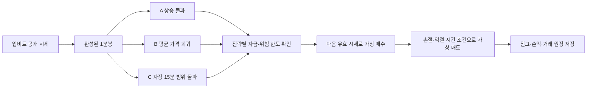

# 시뮬레이션에서 어떻게 사고파는가

현재 AWS 실행은 **1분마다 공개 REST 봉·호가를 조회하는 Lambda 방식**이다. 아래 전략과 자금 규칙을 사용하되 매수·매도는 조회 시점에만 확인한다. 분 사이에 잠깐 손절·익절 가격을 찍은 움직임은 체결로 기록하지 않는다. 로컬 WebSocket 실행은 시세가 들어올 때마다 확인하는 별도 모드다.

실제 업비트 비트코인 시세를 받고, 프로그램 안에서만 돈과 코인을 계산한다. A·B·C 각각 가상 현금 1,000만 원을 받는다. 같은 시세를 세 전략에 동시에 주지만 잔고와 보유 코인은 따로 관리하므로 어느 전략이 나았는지 비교할 수 있다. 기본 종목은 KRW-BTC 한 개다.

## 사는 조건

신호는 1분봉이 끝난 뒤에만 만든다. 신호가 발생한 봉의 과거 가격으로 거슬러 올라가 사지 않고, 신호 이후 들어온 다음 유효 시세로 매수를 계산한다.

| 전략 | 쉬운 설명 | 정확한 조건 |
|---|---|---|
| A | 오르는 흐름에서 거래량을 동반해 최근 고점을 돌파하면 산다. | EMA5 > EMA20, EMA20 상승, 종가 > 당일 VWAP, 직전 6봉 고가 돌파, 거래량 ≥ 직전 20봉 평균의 1.5배 |
| B | 오늘 평균 거래가격보다 싸졌고 반등을 확인하면 산다. | 종가 ≤ 당일 VWAP × 0.996, 종가 > 직전 봉 종가 |
| C | 자정 직후 만든 가격 범위를 위로 넘으면 산다. | 한국 시간 00:00~00:14의 고가를 이후 완성봉 종가가 아래에서 위로 통과 |

VWAP는 거래량으로 가중한 오늘의 평균 거래가격이다. EMA는 최근 가격에 더 큰 비중을 둔 평균이다. 서버는 시작할 때 당일 자정까지 1분봉을 가져와 지표를 준비한다. 초기 REST 데이터는 지표 준비에 사용하고 과거 시점의 가상 거래를 새로 만들지는 않는다.

## 얼마나 사는가

한 번에 한 종목에 넣는 금액은 현재 가상 자산의 최대 20%다. 초기 1,000만 원이면 약 200만 원이 상한이다. 동시에 현금, 전체 투자금 60%, 동시 보유 3종목, 한 거래의 계획 손실 0.5% 한도를 함께 확인해 가장 작은 수량을 쓴다. BTC 한 종목만 실행하는 현재 설정에서는 전략마다 BTC를 한 포지션만 보유할 수 있다.

가상 주문금액이 5,000원 미만이면 건너뛴다. 전략별로 하루 10회 진입, 당일 자산 2% 손실, 손절 카운터 3회의 한도에 걸리면 새 매수를 멈춘다. 손절 카운터는 수익으로 매도하거나 한국 시간 날짜가 바뀔 때 초기화한다. 이미 보유한 코인의 매도 관리는 계속한다. 일일 한도는 한국 시간 날짜가 바뀐 후 새 완성봉을 처리할 때 초기화한다.

## 파는 조건과 체결 비용

매수 후 확인하는 유효 시세마다 다음을 확인한다. 현재 AWS 모드에서는 1분 조회 시점마다 확인한다.

1. 매수 계산 가격보다 1% 이상 하락하면 손절한다.
2. 매수 계산 가격보다 2% 이상 상승하면 익절한다.
3. 둘 다 아니어도 보유 30분이 지나면 매도한다.

매수는 유효 매도호가(ask), 매도는 유효 매수호가(bid)를 기준으로 계산한다. 호가 없이 최근 거래가격만 들어오면 설정한 보수적 스프레드를 추가한다. 매수·매도 각각 0.05% 불리한 가격 변동(슬리피지)과 0.05% 수수료를 반영한다. 따라서 손절·익절의 1%·2%는 비용 차감 후 수익률과 같지 않다.

예를 들어 매도호가가 BTC당 1억 원이면 가상 매수 가격은 슬리피지를 더한 100,050,000원이다. 약 200만 원어치를 사면 매수 수수료 약 1,000원도 현금에서 차감한다. 이 진입 가격의 99%가 손절 기준, 102%가 익절 기준이며 실제 매도 계산에는 다시 매도 슬리피지와 수수료가 붙는다.

10초보다 오래된 시세는 체결에 사용하지 않는다. 매수 신호는 120초가 지나면 만료한다. 연결이 끊기면 새 진입을 멈추고, 재연결 때 빠진 구간의 봉을 지표에만 보충한다. 연결이 끊긴 동안에는 거래를 지어내지 않으므로 데이터 공백 동안 매도 시점이 늦어질 수 있다.

7일 종료 때 남은 코인은 마지막 유효 가격으로 평가해 미실현 손익으로 표시한다. 종료를 이유로 실제로 받지 못한 가격에 매도했다고 기록하지 않는다. 호가 잔량·부분 체결·주문 순서는 아직 모사하지 않는다.
